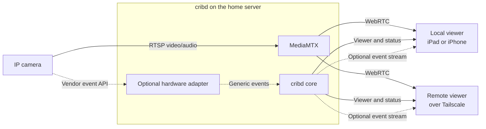

# cribd

`cribd` is a local, private baby-monitor server. Its core job is to take video and audio from an RTSP camera and make the stream available to an iPad or phone through browser-friendly WebRTC.

[MediaMTX](https://github.com/bluenviron/mediamtx) provides the media-routing layer. Optional hardware adapters can add camera-specific events without putting vendor logic into the core server.

> [!WARNING]
> This project is a convenience monitor, not a medical device or a substitute for safe-sleep practices, direct supervision, or any medically indicated monitor. It does not provide breathing, heart-rate, or infant-safety monitoring.

## Status

This project is in the design and prototyping stage. The first target is an Apple-silicon Mac with an iPhone acting as an RTSP camera. The production target is the same ARM64 container stack on a Raspberry Pi 5 with a dedicated IP camera.

## Architecture



The required path is:

```text
camera -> RTSP -> cribd/MediaMTX -> WebRTC -> viewer
```

The event path is optional. Live video and audio must work without an adapter and must continue working if an adapter fails.

## Responsibilities

### cribd core

- Configure the camera's RTSP source.
- Use MediaMTX to route RTSP media to WebRTC.
- Serve the viewer.
- Report camera, stream, and server health.
- Reconnect after stream interruptions.
- Accept and forward generic events when an adapter is configured.

MediaMTX handles RTSP, RTP, WebRTC, and ICE. Depending on configuration, the media packets between the camera and server may travel over UDP or TCP.

### Optional hardware adapter

An adapter owns everything specific to a camera or vendor:

- authentication and connection to the hardware event API;
- event subscription and reconnection;
- capability discovery, such as `motion` or `crying`; and
- translation into a generic event format.

For example:

```json
{
  "type": "crying",
  "active": true,
  "source": "reolink",
  "timestamp": "2026-08-13T23:00:00Z"
}
```

The core does not know how Reolink or another vendor delivers events. With no adapter installed, event features are simply unavailable.

### Viewer

The viewer is a small web/PWA client intended for an always-on iPad, with iPhones as secondary local or remote viewers. It plays WebRTC video and audio, shows connection health, invalidates frozen frames, and displays events when an adapter provides them.

## Interfaces

| Path | Protocol | Purpose |
| --- | --- | --- |
| Camera to MediaMTX | RTSP, with RTP over UDP or TCP | Video and audio |
| MediaMTX to viewer | WebRTC | Low-latency browser playback |
| Camera to adapter | Vendor-specific | Optional hardware events |
| Adapter to `cribd` | Internal event interface | Generic capabilities and events |
| `cribd` to viewer | WebSocket or SSE | Optional event delivery |
| Remote viewer to server | Tailscale | Private remote access |

## Proposed API

The core API is deliberately small:

```text
GET  /api/status
```

When an event adapter is configured, `cribd` may also expose:

```text
WS   /api/events
```

Adapter capabilities and health may appear in the status response only when an adapter is present.

## Requirements

- Local viewing must work without public internet access.
- Camera, stream, and server failures must become obvious within seconds.
- Frozen frames must not continue looking live.
- RTSP reconnection must use bounded backoff.
- The stack must restart automatically after power loss or a process crash.
- Adapter failures must be reported separately and must not interrupt media.
- The camera, MediaMTX, and `cribd` must never be exposed directly to the public internet.
- Remote access must use Tailscale identity and device authorization.
- Camera credentials must remain on the home server and adapter credentials must remain isolated to their adapter.

## Build sequence

1. Prove phone camera -> RTSP -> MediaMTX on Mac -> browser WebRTC.
2. Add the `cribd` viewer, status, explicit offline states, and automatic reconnects.
3. Swap in the production camera and test audio, night vision, and restart recovery.
4. Move the same stack to a Raspberry Pi and configure automatic startup.
5. Add Tailscale and test remote viewing over cellular.
6. Define the generic event interface, then implement Reolink support as a separate adapter.

## Acceptance criteria

### Core

- An iPad reaches live video and audio in one action.
- End-to-end latency feels live.
- An internet outage does not interrupt local viewing.
- The system recovers automatically after the camera or server is power-cycled.
- A dead camera, stream, or server is unmistakably visible within seconds.
- An authorized iPhone can view through Tailscale without public port forwarding.
- The system works with a plain RTSP camera that provides no event API.

### Optional adapters

- `cribd` reports the adapter's capabilities and health.
- Generic events reach connected viewers with negligible application delay.
- Disabling or crashing the adapter does not interrupt video or audio.
- Vendor-specific protocols do not leak into the media core.

## Initial target

- **Camera:** Reolink E1 Pro or another compatible RTSP camera
- **Development server:** Apple-silicon Mac
- **Production server:** Raspberry Pi 5
- **Viewer:** iPad and iPhones
- **Media engine:** MediaMTX
- **Remote network:** Tailscale
- **First optional adapter:** Reolink

## Open questions

- Should adapters run in-process, as plugins, or as isolated sidecars?
- What is the smallest useful generic event envelope?
- How should adapters advertise capabilities and health?
- Should live events use WebSocket or server-sent events?
- Will background events eventually require a native iOS/iPadOS viewer?

## License

Licensed under the [MIT License](LICENSE).
